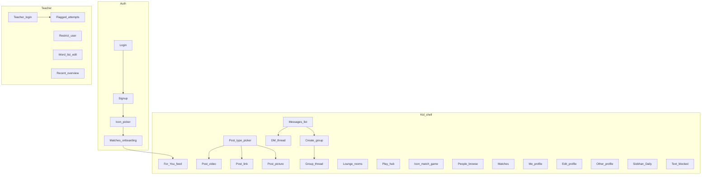

# Rafflesia Online — Screen map
<!-- created: 2026-11-23T19:46:00-08:00 -->
<!-- updated: 2026-11-24T12:45:00-08:00 — Home→For You; Siobhan Daily (PRD v2) -->
<!-- product: PRD v1.0 + v2.0 · process: TASKS.md · tech: TECH.md -->
<!-- next: Phase 2 wireframes (first-cut) — do not skip -->

---

## 1. Purpose
<!-- created: 2026-11-23T19:46:00-08:00 -->

List every Phase-1 screen so wireframes have a checklist.  
**Order:** this map → **wireframes/UX lock** → build.

---

## 2. Defaults (locked)
<!-- created: 2026-11-23T19:46:00-08:00 -->

| Topic | Choice |
|-------|--------|
| Kid nav | For You · Post · Messages · Lounge · People · Me · Siobhan |
| Matches | Post-signup screen + section under People |
| For You (FYP) | Vertical snap feed; search people + media; replaces Home |
| First Play game | Icon match flash |
| Teacher | Separate entry (not a kid tab) |
| Look | Pastel surfaces; brighter buttons/frames |
| Embed | ~520px single column (Google Sites iframe) |

---

## 3. Navigation overview
<!-- created: 2026-11-23T19:46:00-08:00 -->

---

## 4. Screen inventory
<!-- created: 2026-11-23T19:46:00-08:00 -->

### A. Auth and onboarding
<!-- created: 2026-11-23T19:46:00-08:00 -->

| ID | Screen | First-cut? | Primary actions | Empty / error | Notes |
|----|--------|------------|-----------------|---------------|-------|
| A1 | Login | Yes | Log in; go Signup; Teacher link | Bad password | No email field |
| A2 | Signup | Yes | Create account | Username taken | Then A3 |
| A3 | Icon picker | Yes | Pick icon; Continue | None selected | Trendy pack |
| A4 | Matches onboarding | Yes | Follow; Skip/Done | No matches yet | Same/similar icons |

### B. Kid shell
<!-- created: 2026-11-23T19:46:00-08:00 -->

| ID | Screen | First-cut? | Primary actions | Empty / error | Notes |
|----|--------|------------|-----------------|---------------|-------|
| B1 | App shell | Yes | Nav 5 tabs; Logout | — | Pastel card; bright active tab |

### C. Home / Post (map now; wire after first-cut)
<!-- created: 2026-11-23T19:46:00-08:00 -->

| ID | Screen | First-cut? | Primary actions | Empty / error | Notes |
|----|--------|------------|-----------------|---------------|-------|
| C1 | For You (FYP) | Yes | Comment; Send; Share; Delete own; Search | No posts yet | Vertical snap; default tab |
| C2 | Post viewer | Wire-2 | Back | — | Video/pic/link |
| C3 | Post type picker | Wire-2 | Video/Link/Picture | — | Gotcha +POST |
| C4 | Post video | Wire-2 | Choose file; Post | Size too big; text blocked | Text checker |
| C5 | Post link | Wire-2 | Paste URL; Post | Bad URL; text blocked | Text checker |
| C6 | Post picture | Wire-2 | Choose image; Post | Text blocked | Text checker |

### D. Messages (first cut required)
<!-- created: 2026-11-23T19:46:00-08:00 -->

| ID | Screen | First-cut? | Primary actions | Empty / error | Notes |
|----|--------|------------|-----------------|---------------|-------|
| D1 | Messages list | Yes | Open DM/group; New group | No chats yet | DMs + groups |
| D2 | DM thread | Yes | Send; Like | No messages; **text blocked** | Real sender names |
| D3 | Create group | Yes | Name; **pick members**; Create | No people yet | Invite model — see PRD §5.4.1 |
| D3b | Add friends to group | Yes | Multi-select People; Add | Everyone already in | From open group |
| D4 | Group thread | Yes | Send; Like; Add friends | Same as DM | Group title |
| D5 | Text blocked | Yes | Edit message; OK | — | Calm copy |

### E. People / Matches / Me
<!-- created: 2026-11-23T19:46:00-08:00 -->

| ID | Screen | First-cut? | Primary actions | Empty / error | Notes |
|----|--------|------------|-----------------|---------------|-------|
| E1 | People | Yes | Follow; Message | No one else | Browse members |
| E2 | Matches | Yes | Follow | No matches | Icon-based |
| E3 | Me | Yes | Edit; see posts; Delete account | No posts | Banner/avatar/icon |
| E6 | Siobhan Daily | Yes | Open OPUSD Sites link | — | External `noopener` |
| E4 | Edit profile | Yes | Save; change icon; upload | Text blocked on bio | Don’t wipe fields |
| E5 | Other profile | Yes | Follow; Message | — | Their posts |

### F. Play (map now; wire after first-cut)
<!-- created: 2026-11-23T19:46:00-08:00 -->

| ID | Screen | First-cut? | Primary actions | Empty / error | Notes |
|----|--------|------------|-----------------|---------------|-------|
| F1 | Play hub | Wire-2 | Start Icon match | — | One game first |
| F2 | Icon match game | Wire-2 | Play; Done | — | Under ~2 min |

### G. Teacher moderation (Phase 1 now)
<!-- created: 2026-11-23T19:46:00-08:00 -->

| ID | Screen | First-cut? | Primary actions | Empty / error | Notes |
|----|--------|------------|-----------------|---------------|-------|
| G1 | Teacher login | Yes | Enter teacher access | Wrong password | Separate from kids |
| G2 | Flagged attempts | Yes | Open detail | No flags | Who/what/when |
| G3 | Restrict user | Yes | Mute post/msg; Unlock | — | Restrict/unrestrict |
| G4 | Word list | Yes | Add/remove phrases | — | Bad + threat |
| G5 | Recent overview | Yes | Browse posts/chats | Empty club | Light safety view |

---

## 5. Critical flows (wire these)
<!-- created: 2026-11-23T19:46:00-08:00 -->

### Flow 1 — Signup → icon → matches → Home
<!-- created: 2026-11-23T19:46:00-08:00 -->
1. A2 Signup → 2. A3 Icon → 3. A4 Matches (follow optional) → 4. B1+C1 Home  

### Flow 2 — Matches/People → DM
<!-- created: 2026-11-23T19:46:00-08:00 -->
1. E2 or E1 → Message → 2. D2 DM thread → 3. Send ok  

### Flow 3 — Create group → send (ok vs blocked)
<!-- created: 2026-11-23T19:46:00-08:00 -->
1. D1 New group → 2. D3 Create → 3. D4 Send → either ok or **D5 blocked**  

### Flow 4 — Post caption blocked
<!-- created: 2026-11-23T19:46:00-08:00 -->
1. C3 → C4/C5/C6 → bad words → **D5-style block** (no publish); flag for teacher  

### Flow 5 — Teacher flag → restrict
<!-- created: 2026-11-23T19:46:00-08:00 -->
1. G1 → 2. G2 Flagged → 3. G3 Restrict → kid cannot post/message until unlock  

---

## 6. Embed + look (every wire)
<!-- created: 2026-11-23T19:46:00-08:00 -->

- Width target **~520px** (Sites embed / Chromebook).  
- **Surfaces:** pastel only.  
- **Buttons / active tabs / key frames:** brighter solid colors.  
- Logo visible on auth + shell.  

---

## 7. Wireframe checklist
<!-- created: 2026-11-23T19:46:00-08:00 -->

### First-cut (draw before new feature build)
<!-- created: 2026-11-23T19:46:00-08:00 -->
<!-- updated: 2026-11-23T20:00:00-08:00 — drawn in wireframes/index.html (G3) -->

- [x] A1 Login  
- [x] A2 Signup  
- [x] A3 Icon picker  
- [x] A4 Matches onboarding  
- [x] B1 App shell  
- [x] D1 Messages list  
- [x] D2 DM thread  
- [x] D3 Create group (+ member picker)  
- [x] D3b Add friends to group  
- [x] D4 Group thread  
- [x] D5 Text blocked  
- [x] E1 People  
- [x] E2 Matches  
- [x] E3 Me  
- [x] E4 Edit profile  
- [x] E5 Other profile  
- [x] G1 Teacher login  
- [x] G2 Flagged attempts  
- [x] G3 Restrict user  
- [x] G4 Word list  
- [x] G5 Recent overview  

Gallery: [`wireframes/index.html`](wireframes/index.html)

### Wire-second
<!-- created: 2026-11-23T19:46:00-08:00 -->

- [ ] C1 Home feed  
- [ ] C2 Post viewer  
- [ ] C3 Post type picker  
- [ ] C4 Post video  
- [ ] C5 Post link  
- [ ] C6 Post picture  
- [ ] F1 Play hub  
- [ ] F2 Icon match game  

---

## 8. Related
<!-- created: 2026-11-23T19:46:00-08:00 -->

- [`PRD.md`](PRD.md) v1.0  
- [`TASKS.md`](TASKS.md)  
- [`TECH.md`](TECH.md)  
